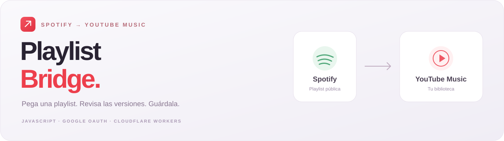
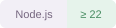
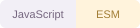
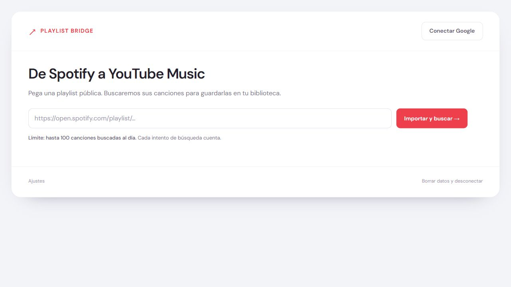

<p align="center">
  
</p>

<p align="center">
  <strong>Tus canciones de Spotify, listas para tu biblioteca de YouTube Music.</strong><br>
  Importa una playlist pública, revisa sus versiones y guarda tu selección.
</p>

<p align="center">
  
  
  
  
</p>

<p align="center">
  <a href="#inicio-rápido">Inicio rápido</a> &nbsp;·&nbsp;
  <a href="#conecta-google">Configurar Google</a> &nbsp;·&nbsp;
  <a href="#despliegue">Despliegue</a> &nbsp;·&nbsp;
  <a href="#límites">Límites</a> &nbsp;·&nbsp;
  <a href="SECURITY.md">Seguridad</a>
</p>

---

## Una playlist, cuatro pasos

**1. Conecta Google.** Elige la cuenta de YouTube que recibirá las canciones.

**2. Pega el enlace.** Importa una playlist pública de Spotify y busca sus canciones automáticamente.

**3. Revisa las versiones.** Cambia una coincidencia, pega otro enlace o excluye canciones.

**4. Guarda la selección.** Crea una playlist privada o añade las canciones a una que ya tengas.

<p align="center">
  
  <br>
  <sub>Captura de una instalación local sin cuentas configuradas.</sub>
</p>

## Qué puedes hacer

- **Importar sin Spotify Premium.** La app consulta el reproductor público de Spotify.
- **Comparar versiones.** Propone hasta tres coincidencias por canción y tiene en cuenta el título, el artista y la duración disponible.
- **Continuar una transferencia.** Conserva el progreso en el navegador y comprueba el destino antes de reanudar una escritura interrumpida.
- **Evitar repeticiones.** Omite canciones repetidas al importar y versiones que ya estén en el destino.
- **Gestionar las esperas.** Espacia peticiones, respeta `Retry-After` y permite detener una espera automática.

## Inicio rápido

Necesitas **Node.js 22 o posterior**. El proyecto no tiene dependencias npm de ejecución.

Desde la carpeta del proyecto:

```sh
npm start
```

Abre **http://localhost:8787**.

La app ya puede leer una playlist pública de Spotify. Para buscar canciones en YouTube y guardarlas, configura Google y pulsa **Conectar Google**.

> [!TIP]
> Puedes probar, ejecutar y compilar esta versión sin ejecutar `npm install`.

## Conecta Google

Configura el proyecto una vez por instalación:

1. Crea o selecciona un proyecto en [Google Cloud](https://console.cloud.google.com/).
2. Habilita **YouTube Data API v3**.
3. Configura la pantalla de consentimiento OAuth. Si está en pruebas, añade las cuentas permitidas como usuarios de prueba.
4. Crea un cliente OAuth de tipo **Aplicación web**.
5. Añade `http://localhost:8787` a sus **orígenes JavaScript autorizados**. Para producción, añade también el origen HTTPS exacto de tu despliegue, sin rutas.
6. Configura el **Client ID** mediante una de las opciones siguientes e inicia sesión desde la app.

<details>
<summary><strong>Opción A · Configuración local con .env</strong></summary>

Copia `.env.example` a `.env` en la raíz del proyecto y completa el identificador:

```dotenv
GOOGLE_CLIENT_ID=tu-client-id.apps.googleusercontent.com
PORT=8787
```

Reinicia `npm start` después de cambiar el archivo. `.env` está excluido de Git.

</details>

<details>
<summary><strong>Opción B · Configuración desde la interfaz</strong></summary>

Abre **Ajustes**, pega el Client ID y guarda. El identificador se conserva en ese navegador.

Es útil para probar la app sin crear un archivo de configuración.

</details>

<details>
<summary><strong>Opción C · Configuración en el alojamiento</strong></summary>

Añade `GOOGLE_CLIENT_ID` como variable de configuración del Worker. La ruta `/api/config` devuelve únicamente ese identificador validado; el resto del entorno queda en el servidor.

Recuerda autorizar el dominio del despliegue en Google Cloud.

</details>

> [!IMPORTANT]
> **Tu cuenta de YouTube no se incluye en el código.** Cada persona inicia sesión y autoriza su propia cuenta. Para gestionar playlists, esa cuenta debe disponer de un canal de YouTube. La cuota del proyecto OAuth se comparte entre sus usuarios.

### Credenciales: qué se ve y qué se guarda

El **Client ID es público** y debe llegar al navegador para iniciar OAuth. Separarlo del repositorio facilita la configuración; seguirá siendo visible durante la autorización de Google.

Este flujo funciona sin API key ni Client Secret. El token de Google se conserva **solo en memoria** y desaparece al recargar. Los metadatos y el progreso se guardan en `localStorage`.

Antes de abrir el acceso a otras personas, revisa los requisitos de consentimiento y verificación de Google. Más detalles en [SECURITY.md](SECURITY.md).

## Despliegue

### Cloudflare Workers

El proyecto incluye `wrangler.jsonc` sin datos de cuenta. Puedes cambiar el nombre del Worker antes de desplegar.

```sh
npx wrangler deploy
```

Wrangler solicita acceso a tu cuenta de Cloudflare y ejecuta el build configurado. El comando puede descargar Wrangler desde npm si aún no está disponible.

Después del despliegue:

- Añade `GOOGLE_CLIENT_ID` como variable del Worker, o configúralo desde Ajustes.
- Autoriza el origen HTTPS de la app en Google Cloud.
- Si la instalación será privada, configura el control de acceso en el alojamiento.

> [!NOTE]
> **GitHub aloja el código.** GitHub Pages por sí solo no ejecuta el servicio que importa las playlists de Spotify. La app necesita el Worker o el servidor incluido en este proyecto.

## Límites

> [!WARNING]
> La cuota predeterminada es de **100 búsquedas al día por proyecto de Google**. Cada intento cuenta y una canción puede necesitar más de uno. No equivale a 100 canciones garantizadas.

- Los límites reales y el consumo se consultan en Google Cloud.
- Ante un límite temporal, la app espera y hace como máximo **tres reintentos automáticos por petición**. Una cuota agotada no se reintenta en bucle.
- Spotify puede mostrar solo parte de una playlist pública y cambiar el formato de su reproductor. Comprueba el total importado.
- Las coincidencias son propuestas automáticas. Revisa la versión antes de guardarla.
- YouTube Music puede ocultar vídeos que no considere musicales.
- El progreso se conserva en el navegador donde lo iniciaste.

## Desarrollo y comprobaciones

```sh
# Ejecutar las pruebas
npm test

# Buscar patrones habituales de credenciales e identificadores personales
npm run check:secrets

# Generar el Worker y sus recursos
npm run build
```

Las pruebas usan respuestas simuladas y datos de ejemplo. Comprueban búsquedas, selección, transferencias interrumpidas, cuotas, reintentos y configuración. No necesitan credenciales ni modifican playlists reales.

<details>
<summary><strong>Estructura del proyecto</strong></summary>

```text
playlist-bridge/
├── public/                 Interfaz y lógica del navegador
│   ├── app.js              Conexión, importación y estado
│   ├── matching.js         Búsqueda y comparación de versiones
│   ├── transfer.js         Guardado y recuperación de transferencias
│   └── rate-limit.js       Esperas, ritmo de peticiones y reintentos
├── worker/                 Importación pública de Spotify y configuración
├── scripts/                Build y revisión de credenciales
├── tests/                  Pruebas con servicios simulados
├── docs/assets/            Portada, insignias y captura del README
├── server.mjs              Servidor local
├── wrangler.jsonc          Configuración de Cloudflare Workers
├── .env.example            Variables de ejemplo
└── SECURITY.md             Tratamiento de credenciales y datos
```

`npm run build` genera `dist/index.js`. Los archivos generados están excluidos de Git.

</details>

## Preparado para GitHub

Esta copia no incluye cuentas preconfiguradas, credenciales reales, identificadores del alojamiento original ni historial Git.

Antes de subirla:

1. Ejecuta `npm run check:secrets` y revisa los cambios.
2. Mantén fuera del repositorio `.env`, `.dev.vars`, cookies, tokens y exportaciones de progreso.
3. Inicia un repositorio nuevo en esta carpeta; evita copiar el historial `.git` de otra instalación.

La revisión automática busca patrones conocidos y no sustituye la inspección de los archivos que publiques.

---

<p align="center">
  <strong>Documentación oficial</strong><br><br>
  <a href="https://developers.google.com/identity/oauth2/web/guides/use-token-model">Google OAuth</a> &nbsp;·&nbsp;
  <a href="https://developers.google.com/youtube/data/determine_quota_cost">Cuotas de YouTube</a> &nbsp;·&nbsp;
  <a href="https://developers.cloudflare.com/workers/wrangler/configuration/">Cloudflare Workers</a> &nbsp;·&nbsp;
  <a href="SECURITY.md">Seguridad del proyecto</a>
</p>
